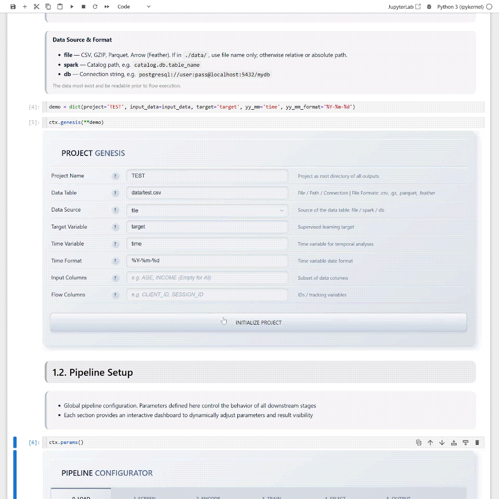

<h1 align="center">


</h1>

<div align="center">

**Automated Interactive Development Framework**<br />**Human-in-the-Loop Scorecard Orchestration for Regulated ML**

[](https://pypi.org/project/aidflow/)
[](https://pypi.org/project/aidflow/)
[](https://fsl.software/)
[](https://github.com/psf/black)

</div>

<div align="center">

*Built over 15 years of credit scoring, fintech R&D, and regulatory practice.*

[](https://github.com/aigensys-labs/aidflow/blob/main/docs/assets/aidflow.jpg)


**A human directs. An AI agent executes. The output survives committee review.**

</div>

---

## Why AIDflow?

Automated ML tools optimize metrics in isolation and hand you a black box.
In regulated environments — **Fintech, Banking, Insurance** — that's a liability, not an asset.

AIDflow treats every model as an **auditable legal artifact**. It automates the pipeline mechanics while keeping a human in control of every decision: feature selection, binning strategy, model choice, champion deployment. Full transparency, full traceability, full reproducibility.

It is also an **AI-orchestrable endpoint** — an endpoint that lets LLM agents drive the full pipeline (genesis → training → champion) and return a deployable, regulatory-grade scorecard without human intervention.

**If your scoring model must survive a committee review, AIDflow is your development environment.**

---

## Quick Start

### Install & Run Demo

```bash
# Pure CLI
pip install aidflow
aidflow run demo/

# Interactive UI 
pip install aidflow[notebook]
aidflow notebook ui_demo/
```

### Define & Run Your Project in CLI / Notebook

```python
import aidflow as aid

# Project Context
ctx = aid.ProjectContext()

ctx.genesis(
    project      = 'my_scorecard',
    input_data   = 'data/train.csv',
    target       = 'is_churn',
    yy_mm        = 'decision_date',
    yy_mm_format = '%Y-%m-%d',
)
ctx.params(save=1, logging=1, verbose=1)

# Execute Full Pipeline
ctx.flow.process('all')

# Or Run Phase-by-Phase
ctx.flow.process('data')
ctx.flow.process('encoding')
ctx.flow.process('training')
ctx.flow.process('selection')
```

### Inference Tests

```python
pred = aid.Predictor(project='my_scorecard')
score = pred.champion_predict(new_data, preprocess=True)
```

### Export Production Artifact

```python
prod = aid.ProductionExporter(ctx.selection.champion_predictor)
prod.export_all('./production')
# → self-contained scoring module
```


[](https://github.com/aigensys-labs/aidflow/blob/main/docs/assets/aidflow-preview.gif)

---

## Documentation

📚 [**View Full Documentation → aidflow.aigensys.com**](https://aidflow.aigensys.com)

- [Getting Started](https://aidflow.aigensys.com/getting-started/overview)
- [User Guides](https://aidflow.aigensys.com/user-guides/data-phase)
- [API Reference](https://aidflow.aigensys.com/api/execution-interface/Parameters)

---


## Capabilities

- **Human-in-the-Loop** — Every phase is a decision point. Pause, inspect, re-configure, re-run — without losing state.
- **Ensemble + Selection** — Four orthogonal agents compete. An objective scoring system promotes the champion.
- **Audit-Ready** — Per-step standardized artifacts: stability indices (PSI/CSI), lift tables, calibration, feature lineage, SHAP vectors.
- **Self-Contained Scoring** — The exported artifact encapsulates all encoding and model state. Inference requires no training data or prior pipeline state.
- **Memory-Aware Relay** — Offloads intermediate state to disk via Arrow. Run pipelines on a 16GB machine. `ctx.params(offload=1)`.
- **Distributed Compute** — Swap from local multiprocessing to Ray cluster for multi-node scaling. `pip install aidflow[ray]`. No pipeline changes.

---

## Architecture

AIDflow decouples **user intent** from **mathematical execution** via a three-layer stack. Swap algorithms without touching the API.

| Layer      | Role      | Responsibility                                            |
|------------|-----------|-----------------------------------------------------------|
| **Worker** | Interface | User-facing API. Validation, state, registration, UI.     |
| **Model**  | Adapter   | Parameter resolution. Algorithm switching. Fit options.   |
| **Fitter** | Engine    | Pure computation. No UI, no context. Data in → model out. |


**Practical effect:** switch from Lasso to ElasticNet by passing one parameter. The worker API, the state schema, and the reporting pipeline remain unchanged.

---

## Traditional ML vs AIDflow

| Dimension           | Traditional                                    | AIDflow                                                                    |
|---------------------|------------------------------------------------|----------------------------------------------------------------------------|
| **Data flow**       | Variable passing (`df1` → `df2` → ... → `dfN`) | Context registration (semantic lineage)                                    |
| **Architecture**    | Monolithic script                              | Worker → Model → Fitter (swappable layers)                                 |
| **Extension**       | Rewrite the function                           | Define a new Fitter, register it. Done.                                    |
| **Stability**       | Manual checks, date slicing                    | Built-in temporal phases (pre-training)                                    |
| **Memory**          | RAM-bound. Sample or add hardware.             | Arrow offload. Runs on any machine.                                        |
| **Compute**         | `multiprocessing` or manual `joblib`           | Local multiprocessing (default) → Ray cluster (one param)                  |
| **Reproducibility** | "Works on my machine"                          | Context-locked. Run-to-run identical.                                      |
| **AI**              | Manual step-by-step orchestration              | Single-call pipeline → production DAG. Stateless, idempotent, AI-friendly. |

---

## Execution Pipeline

*GENESIS → DATA → ENCODING → TRAINING → SELECTION → INFERENCE*

|                                                                                                    |
|----------------------------------------------------------------------------------------------------|
| 📊 **Data** — Loader, Fe Cleaner, Fe Stabilizer, Obs Stabilizer                                    |
| 🔢 **Encoding** — Num Encoder, Cat Encoder, Ixn Encoder, WOE Encoder, WOE Stabilizer, Data Encoder |
| 🤖 **Training** — Agent 1 (GLM), Agent 2 (L1/L2), Agent 3 (PLS), Agent 4 (GBM)                     |
| 🏆 **Selection** — Agents Predictor, Comparator, Transition, Selector, Champion                    |
| 🎯 **Inference** — Production Predictor, Production Export                                         |

> **Human-in-the-Loop:** Interactive adjustments, pause, inspect, re-configure at every boundary

---

## Requirements

- Python **3.12+**
- [Dependencies](https://github.com/aigensys-labs/aidflow/blob/main/pyproject.toml)

---

## Licensing

**Functional Source License (FSL 1.1)** with automatic Apache 2.0 grant after 2 years.

- **Permitted**: Internal use, non-commercial education/research, professional services delivery.
- **Restricted**: Building a competing commercial product on top of AIDflow's core engine.
- **After 2 years**: Automatically converts to **Apache 2.0** (full open source, no restrictions).

[Full license → LICENSE](https://github.com/aigensys-labs/aidflow/blob/main/LICENSE) |
[Learn more → fsl.software](https://fsl.software/)

---

## Citation

```bibtex
@software{AIDflow,
  author = {Michal Ricar, PhD},
  year = {2026},
  publisher = {AIGENSYS s.r.o.},
  title = {AIDflow: Automated Interactive Development Framework for Regulated Scorecard Orchestration},
  url = {https://github.com/aigensys-labs/aidflow}
}
```

---


*Built for practitioners who build models that must survive a regulatory audit.*